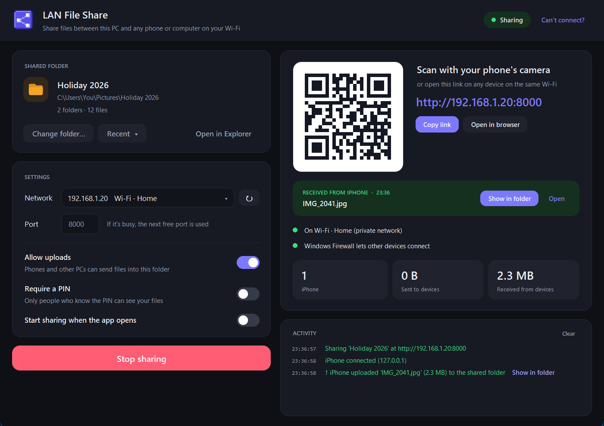
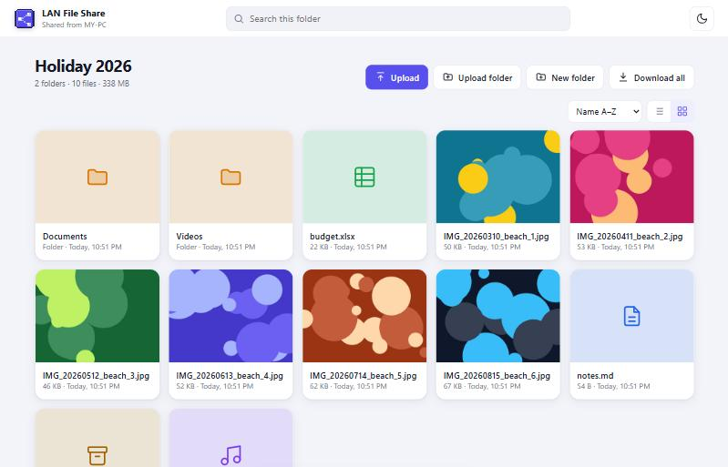
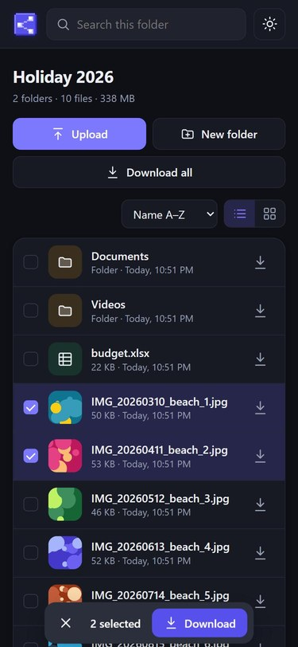

<p align="center">
  
</p>

<h1 align="center">LAN File Share</h1>

<p align="center">
  Share a folder from your Windows PC with any phone, tablet or computer on the same Wi-Fi.<br>
  No app to install on the phone, no cable, no cloud — just scan a QR code.
</p>

<p align="center">
  <a href="https://github.com/Rajasekhar-Ilaparti/LAN-File-Share/releases/latest/download/LAN-File-Share-Setup.exe"><b>⬇ Download for Windows</b></a>
  &nbsp;<a href="https://github.com/Rajasekhar-Ilaparti/LAN-File-Share/releases/latest"></a>
  &nbsp;·&nbsp;
  <a href="https://github.com/Rajasekhar-Ilaparti/LAN-File-Share/releases/latest">All releases</a>
</p>

<p align="center">
  
</p>

## Features

- **Scan and go** — a QR code opens the shared folder in the phone's browser (iPhone, Android, any PC or Mac).
- **Modern file browser** — list and grid views, photo thumbnails, search, sorting, light and dark themes.
- **Preview before downloading** — photos (swipe between them), videos with seeking, music, PDFs and text files.
- **Download anything** — single files, several selected files, or whole folders as one ZIP.
- **Receive files from your phone** — optional uploads with drag-and-drop, folder uploads, progress, speed and automatic retries. Each received file gets a **Show in folder** button on the PC.
- **Optional PIN** — only people who know the 6-digit PIN can see your files; scanning the QR code signs them in.
- **Fixes connection problems** — picks the right network, avoids busy ports, and offers one-click Windows Firewall setup (for local-network devices only). Phones show a banner and reconnect automatically if the PC goes away.
- **Private by design** — files go directly over your own network and never leave it.
- **Updates itself** — when a new version is out, an **Update** button appears; one click downloads and installs it. The check only asks GitHub for the latest version number and can be turned off under **Settings → Check for updates**.

<p align="center">
  
  &nbsp;
  
</p>

## Install

1. Download the latest **[LAN-File-Share-Setup.exe](https://github.com/Rajasekhar-Ilaparti/LAN-File-Share/releases/latest/download/LAN-File-Share-Setup.exe)**.
2. Run it. Windows may show **"Windows protected your PC"** because the installer isn't code-signed — click **More info → Run anyway**.
3. Tick **"Let phones on my network connect"** during setup (recommended), then finish.

No administrator password is needed unless you choose the firewall option or "install for all users".
Uninstall any time from **Settings → Apps**.

### System requirements

| | |
|---|---|
| Windows | 11, 10 or 8.1 — 64-bit |
| Phone / other device | Any modern browser on the same Wi-Fi or Ethernet network |

## How to use

1. Connect your phone to the **same Wi-Fi** as your PC.
2. Open LAN File Share, choose a folder and press **Start sharing**.
3. Scan the QR code with your phone's camera (or type the address shown).

### If a phone can't connect

- Make sure both devices are on the same network (not mobile data, not a guest Wi-Fi).
- Press **Fix connection** in the app if it warns about Windows Firewall.
- Turn off VPN apps on the PC and phone.
- Type the address exactly as shown, starting with `http://`.
- On public or guest Wi-Fi, turn on **Mobile hotspot** on the PC and connect the phone to it.

## Build from source

Requirements: Python 3.11, then

```bash
pip install pyinstaller pillow qrcode
```

Run the app directly:

```bash
python file_share_app.py
```

Build `dist\LAN File Share.exe` and the installer `installer\Output\LAN-File-Share-Setup.exe` (needs [Inno Setup 6](https://jrsoftware.org/isinfo.php), e.g. `winget install JRSoftware.InnoSetup`):

```bash
build_installer.bat
```

## Releasing a new version

1. Change `APP_VERSION` at the top of `file_share_app.py` (for example to `"5.1"`) and commit.
2. Tag that commit with the same version and push the tag:

   ```bash
   git tag v5.1
   git push origin v5.1
   ```

GitHub Actions ([`.github/workflows/release.yml`](.github/workflows/release.yml)) then builds the app and installer on Windows and publishes a release with `LAN-File-Share-Setup.exe`. Installed copies of the app see the new version and offer to update. The build stops if the tag and `APP_VERSION` don't match.

## License

[MIT](LICENSE)
